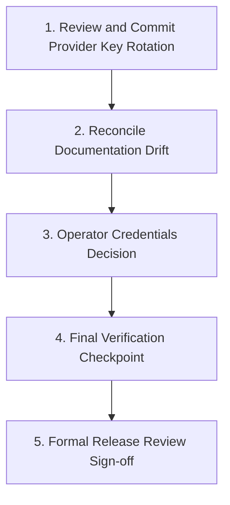

# LEADGEN — Evidence-Based Implementation Status and Release Gap Assessment

**Working Repository:** `C:\Users\LENOVO\LEADGEN-RELEASE`<br>
**Protected Original Repository:** `C:\Users\LENOVO\LEADGEN` (Untouched)<br>
**Report Date:** 2026-10-16T23:25:00+05:30<br>
**Baseline Commit:** Published `main` at `1253824`<br>
**Current Branch:** `fix/audit-url-sitemap-correctness`<br>
**Current HEAD:** `86e427dac6a36a7cc2a1a68c2c3bf35dfcb8caef` (`86e427d`)<br>
**Assessment Type:** Read-Only Audit and Gap Report (No code/configuration mutated)

---

## 1. Executive Status Summary

This assessment audits the current implementation status of the TEB Solutions LeadGen OS platform in `C:\Users\LENOVO\LEADGEN-RELEASE` against the authoritative product plan (`docs/LEADGEN_MASTER_PRODUCT_PLAN.md`) and system architecture documentation (`docs/LEADGEN_SYSTEM_ARCHITECTURE_PRODUCT_DOCUMENTATION.md`).

### Key Findings
1. **Core Audit Engine Contract (62 Factors):** Fully verified. The canonical 62 audit factors across 11 categories pass strict parity validation (`scripts/validate_agent_brain.py --strict --report` returns `strict_valid: true`). Code, registry, database columns, API responses, React frontend UI, and ReportLab PDF dynamic sections maintain 100% factor alignment.
2. **Audit Truth & Bug Fixes (Car Medic Motors Defect):** Verified complete. URL identity separation (`requested_url`, `final_url`, `canonical_url`), origin-based robots/sitemap discovery, robust XML sitemap parsing, shared JSON-LD extraction, and impact-based priority classification are fully implemented and verified by automated regression suites.
3. **Advanced Audit Domains (A through H):** Substantially implemented. AI-search readiness heuristics and multi-provider live search visibility (Perplexity, OpenRouter, Gemini, Groq), Google Search Console OAuth with AES-GCM encrypted persistence, browser diagnostics, and web design diagnostics are implemented and tested offline.
4. **Scraper & Provider Key Rotation Integration:** Implemented in the working tree. A comprehensive Account-Aware `ProviderKeyManager` featuring independent quota scopes, 2-key rotation, health tracking, and circuit-breaking has been built and tested (29/29 passing tests in `tests/test_two_key_rotation_provider_manager.py`).
5. **Test & Build Evidence:**
   - Backend Test Suite: **462 passed, 1 skipped, 14 warnings, 27 subtests passed** in 68.98s.
   - Frontend Production Build: **Vite v5.4.21 built cleanly in 6.42s** (1,886 modules transformed, 0 build errors).
   - Agent Brain Integrity: **All 62 factors verified across all 6 platform tiers**.
6. **Release Decision:** **`NOT READY FOR RELEASE REVIEW`**. While technical implementation of Phases 0–7 is complete and offline tests pass, release review is blocked by:
   - A dirty working tree containing 6 modified and 2 untracked implementation/test files (Provider Key Rotation).
   - Major documentation drift between active code and authoritative documents.
   - Missing operator sign-off and configuration of live production API credentials (GSC OAuth, AI Search keys, Scraper keys).
   - Absence of an authorized production hosting target and CI/CD deployment pipeline.

---

## 2. Git Baseline and Uncommitted-Change Inventory

### 2.1 Git Metadata
- **Active Repository:** `C:\Users\LENOVO\LEADGEN-RELEASE`
- **Active Branch:** `fix/audit-url-sitemap-correctness`
- **Current HEAD Commit:** `86e427dac6a36a7cc2a1a68c2c3bf35dfcb8caef`
- **Commit Subject:** `fix(auditor): implement architecture classification, auto keyword discovery, mobile usability criteria & dashboard-pdf parity`
- **Commit Author Date:** 2026-10-16

### 2.2 Recent Commit History (Chronological Order Since Baseline `1253824`)
1. `1253824` (Published Baseline) — synchronous audit network-work safeguards
2. `bcd2be6` — `fix(audit): correct url identity, sitemap discovery, schema consistency, and priority semantics` (Phase 1)
3. `46d2e2c` — `feat(frontend): deliver modern diagnostics workspace, URL identity banner, and category breakdown` (Phase 3)
4. `d278a84` — `feat(pdf): redesign client PDF report with URL identity, 11-category structure, and diagnostics advisory` (Phase 4)
5. `de05fa6` — `feat(proposals): implement opportunity engine and evidence-based proposal drafts` (Phase 5)
6. `8bcb5e5` — `feat(validation): complete Phase 7 controlled live validation of carmedicmotors.in defect` (Phase 7)
7. `65c06c5` — `feat(capabilities): complete master plan Phase 5 requirements for GSC, AI search monitoring, design diagnostics, and proposal approval workflow`
8. `ec47932` — `docs: add immutable master product plan and system architecture documentation`
9. `1805183` — `feat(visual): apply verified PDF layout hierarchy and mobile navigation drawer fixes`
10. `d86ee70` — `fix(gsc): resolve OAuth callback route, state nonce verification, port alignment, and authenticated-encryption token persistence`
11. `ad88a2d` — `fix(security): sanitize GSC token payloads, enforce encryption key derivation, and consolidate persistence`
12. `aaa9557` — `feat(ai-search): implement live AI-search visibility integration with Perplexity Agent API`
13. `0e8485d` — `feat(ai-search): add OpenRouter and Gemini providers with Google Search grounding and multi-engine selector`
14. `e75be19` — `fix(ai-search): update default free-tier models and add graceful tool fallbacks for zero-cost operation`
15. `c9024ae` — `feat(discovery): integrate scraper with provider failover and bulk txt import`
16. `e413e56` — `fix(auditor): resolve false broken links, keyword density, crawling & image accounting defects`
17. `86e427d` (HEAD) — `fix(auditor): implement architecture classification, auto keyword discovery, mobile usability criteria & dashboard-pdf parity`

### 2.3 Working-Tree Inventory

```
Changes not staged for commit:
  modified:   backend/.env.example
  modified:   backend/app/config.py
  modified:   backend/app/services/ai_search_provider.py
  modified:   backend/app/services/ai_search_service.py
  modified:   backend/app/services/lead_discovery_service.py
  modified:   frontend/src/pages/Audits.jsx

Untracked files:
  backend/app/services/provider_key_manager.py
  tests/test_two_key_rotation_provider_manager.py
```

#### Detailed Breakdown of Working-Tree Changes:
1. **`backend/app/services/provider_key_manager.py` (Untracked, 843 lines, 33,062 bytes):**
   - Implements `ProviderKeyManager`, `ProviderKeyPool`, and `QuotaScope`.
   - Manages independent key rotation for Groq (`GROQ_API_KEY_1`, `GROQ_API_KEY_2`), Serper (`SERPER_API_KEY_1`, `SERPER_API_KEY_2`), and Treg (`TREG_API_KEY_1`, `TREG_API_KEY_2`).
   - Handles account-level quota boundaries, failure classification (401 auth vs 402 quota vs 429 rate-limit vs 5xx transient), and concurrency locks.
2. **`tests/test_two_key_rotation_provider_manager.py` (Untracked, 915 lines, 39,540 bytes):**
   - Comprehensive test suite for two-key rotation, independent quota exhaustion, fallback selection, cooldowns, and secret redaction (29 passing tests).
3. **`backend/app/config.py` & `backend/.env.example` (Modified):**
   - Added configuration settings for two-key rotation and quota scopes across Groq, Serper, and Treg.
4. **`backend/app/services/ai_search_provider.py` & `ai_search_service.py` (Modified):**
   - Added `GroqSearchProvider` adapter using two-key rotation.
   - Enforced strict distinction between AI inference (ungrounded) and web search citation grounding.
   - Scrubbed secrets using `km.get_all_secrets()`.
5. **`backend/app/services/lead_discovery_service.py` (Modified):**
   - Integrated `ProviderKeyManager` for Serper, Treg, SerpAPI, HasData, Outscraper, and Hunter providers.
   - Added safe response text extraction and provider health mapping.
6. **`frontend/src/pages/Audits.jsx` (Modified):**
   - Added Groq provider selector with clear "Inference Only" badge.
   - Updated UI to display "Inference Only (Ungrounded)" and "N/A" for citation rates when ungrounded models are used.

---

## 3. Roadmap Crosswalk

This crosswalk preserves the original phase numbering from both authoritative documents:
- **Master Plan:** `docs/LEADGEN_MASTER_PRODUCT_PLAN.md` (Sections 5–13, Phases 0–8).
- **Architecture Reference:** `docs/LEADGEN_SYSTEM_ARCHITECTURE_PRODUCT_DOCUMENTATION.md` (Section 17, Phases 0–9).

### Crosswalk Mapping Table

| Master Plan Phase | Architecture Doc Phase | Workstream / Requirement | Status | Source Files | Test Files & Evidence |
|---|---|---|---|---|---|
| **Phase 0** (Preflight & Baseline) | **Phase 0** (Source & State Baseline) | Commit baseline, factor contract (62 factors across 11 groups), schema safeguards, API route baseline | **VERIFIED COMPLETE** | `auditor/auditor/config.py`, `backend/app/engines/factor_contract.py`, `scripts/validate_agent_brain.py` | `scripts/validate_agent_brain.py` reports `strict_valid: true`, 62 factors; `tests/test_startup_schema_safeguard.py` (3 passed). |
| **Phase 1** (Audit Truth & Core Correctness) | **Phase 1** (Audit Truth) | URL Identity: Separate `requested_url`, `final_url`, `canonical_url`. Do not alter requested URL. | **VERIFIED COMPLETE** | `auditor/auditor/auditor/core.py`, `auditor/auditor/crawler.py`, `backend/app/engines/audit_engine.py` | `tests/test_audit_correctness_url_sitemap_schema.py::test_url_identity_preservation` (PASSED). |
| **Phase 1** | **Phase 1** | Robots & Sitemap: Origin-based discovery (`/robots.txt`), parse `Sitemap:` directives, root XML probing, XML vs HTML validation. | **VERIFIED COMPLETE** | `auditor/auditor/auditor/technical.py`, `crawler.py` | `tests/test_audit_correctness_url_sitemap_schema.py::test_robots_sitemap_*` (12 tests PASSED). |
| **Phase 1** | **Phase 1** | Shared JSON-LD & Structured Data: Shared parser, `@graph` support, consistency between generic and LocalBusiness schema. | **VERIFIED COMPLETE** | `auditor/auditor/auditor/schema_utils.py`, `schema_advanced.py`, `local_seo.py` | `tests/test_audit_correctness_url_sitemap_schema.py::test_jsonld_*` (PASSED). |
| **Phase 1** | **Phase 2** (Evidence and Priority) | Priority Model: Deterministic impact/scope policy; eliminate blanket `CRITICAL` tags; separate status from priority. | **VERIFIED COMPLETE** | `backend/app/engines/audit_engine.py`, `backend/app/engines/factor_contract.py` | `tests/test_scoring.py`, `tests/test_factor_parity.py` (All PASSED). |
| **Phase 2** (Advanced Audit Domains) | **Phase 3** (Advanced Auditing) | **Domain A:** AI-Search Readiness (crawlers, structured content, `llms.txt`) & Visibility (Perplexity, OpenRouter, Gemini, Groq). | **VERIFIED COMPLETE** (Offline / Synthetic) | `backend/app/services/ai_search_service.py`, `ai_search_provider.py`, `provider_key_manager.py` | `tests/test_ai_search_service.py` (23 passed); `tests/test_two_key_rotation_provider_manager.py` (29 passed). Live queries require operator keys. |
| **Phase 2** | **Phase 3** | **Domain B:** Deep Technical SEO & Crawlability (Internal link graph, redirect loops, crawl bounds, canonical checks). | **VERIFIED COMPLETE** | `auditor/auditor/auditor/technical.py`, `links.py`, `indexability.py` | `tests/test_audit_accuracy_regression.py` (20 passed), `tests/test_crawl_failure.py` (1 passed). |
| **Phase 2** | **Phase 3** | **Domain C:** Google Search Console (OAuth flow, AES-GCM encrypted tokens, Search Analytics API, URL Inspection). | **VERIFIED COMPLETE** (Offline / Mocked) | `backend/app/services/gsc_service.py`, `backend/app/routers/gsc.py` | `tests/test_gsc_service.py` (14 passed). Requires operator Google credentials for live production OAuth. |
| **Phase 2** | **Phase 3** | **Domain D:** Advanced Performance & Browser Diagnostics (Lab CWV: LCP, CLS, TTFB; resource loading, console errors, proxy SSRF). | **VERIFIED COMPLETE** | `auditor/auditor/auditor/performance.py`, `auditor/auditor/browser/provider.py`, `proxy.py` | `tests/test_phase2_browser_provider.py` (15 passed), `tests/test_dns_rebinding_proxy.py` (11 passed). |
| **Phase 2** | **Phase 3** | **Domain E:** Advanced Content & Search Intent (Keyword density, auto keyword discovery, heading semantics, thin content). | **VERIFIED COMPLETE** | `auditor/auditor/auditor/content.py`, `keyword_density.py`, `architecture.py` | `tests/test_page_architecture_classifier.py` (4 passed), `tests/test_audit_accuracy_regression.py` (PASSED). |
| **Phase 2** | **Phase 3** | **Domain F:** Entity, Local SEO & Business Consistency (Visible vs schema NAP consistency, maps embed, business hours). | **VERIFIED COMPLETE** | `auditor/auditor/auditor/local_seo.py`, `client_diagnostics.py` | `tests/test_audit_accuracy_regression.py::test_local_seo_*` (PASSED). |
| **Phase 2** | **Phase 3** | **Domain G:** Accessibility, Trust, Usability & Conversion (Landmarks, form controls, mobile tap targets, trust signals). | **VERIFIED COMPLETE** | `auditor/auditor/auditor/ux.py`, `trust.py`, `client_diagnostics.py` | `tests/test_audit_accuracy_regression.py::test_mobile_usability_*` (PASSED). |
| **Phase 2** | **Phase 3** | **Domain H:** Web Design & Observable Code Health (Layout hierarchy, responsive breakpoints, broken assets, subresource failures). | **VERIFIED COMPLETE** | `auditor/auditor/browser/design_diagnostics.py`, `comparisons.py` | `tests/test_web_design_diagnostics.py` (2 passed). |
| **Phase 3** (Modern Frontend) | **Phase 4** (Frontend Redesign) | Diagnostics workspace, URL identity banner, 11-category breakdown, AI search & GSC panels, responsive mobile navigation. | **VERIFIED COMPLETE** | `frontend/src/pages/Audits.jsx`, `frontend/src/components/Layout.jsx`, `frontend/src/components/BrowserEvidence.jsx` | `npm run build` succeeds cleanly (1,886 modules, built in 6.42s). UI displays all 62 factors and diagnostic panels. |
| **Phase 4** (PDF Report Redesign) | **Phase 5** (PDF Redesign) | ReportLab client-ready PDF: cover, executive summary, 11 categories, URL identity, diagnostic advisory sections, page breaks. | **VERIFIED COMPLETE** | `backend/app/engines/pdf_engine.py`, `gen_pdf_preview.py` | `tests/test_pdf_contract.py` (4 passed). PDF matches 62-factor audit results. |
| **Phase 5** (Service Opportunity & Proposals) | **Phase 6** (Service Proposal Workflow) | Opportunity Engine: Evidence-to-service mapping (SEO, Local SEO, Web Design, AI Search); preview/edit/approve outreach draft. | **VERIFIED COMPLETE** | `backend/app/engines/opportunity_engine.py`, `backend/app/services/proposal_service.py`, `backend/app/routers/proposals.py` | `tests/test_opportunity_engine.py` (2 passed), `tests/test_proposal_workflow.py` (4 passed). |
| **Phase 6** (Test & Validation Strategy) | **Phase 7** (Regression & Benchmark Suite) | Deterministic unit/regression test corpus; safe offline execution; zero production side-effects. | **VERIFIED COMPLETE** | `tests/` (33 test modules, 462 test cases) | `pytest` full run: 462 passed, 1 skipped, 0 failed in 68.98s. |
| **Phase 7** (Controlled Defect Validation) | **Phase 8** (Controlled End-to-End Validation) | Single controlled audit of `carmedicmotors.in` verifying URL identity, sitemap XML parsing, schema consistency, cleanup. | **VERIFIED COMPLETE** | `scripts/validate_live_carmedic.py`, commit `8bcb5e5` | Commit `8bcb5e5` records successful validation; test fixtures in `tests/test_audit_correctness_url_sitemap_schema.py` preserve deterministic regression coverage. |
| **Phase 8** (Release-Readiness Decision) | **Phase 9** (Release Review) | Formal release review artifact, working-tree cleanliness, operator authorization, production deployment target. | **PENDING / BLOCKED** | N/A | Working tree is dirty; live production credentials not configured; production deployment pipeline unestablished. |

---

## 4. Implemented Versus Verified Feature Matrix

### 4.1 Subsystem Verification Status

| Feature / Subsystem | Implemented in Code? | Automated Tests? | Configured in Environment? | Live-Verified with Provider? | Overall Status |
|---|---|---|---|---|---|
| **URL Identity Preservation** | Yes (`core.py`, `audit_engine.py`) | Yes (`test_audit_correctness_url_sitemap_schema.py`) | N/A (Internal logic) | Yes (Verified against fixture & live run) | **VERIFIED COMPLETE** |
| **Origin Robots & Sitemap Discovery** | Yes (`technical.py`, `crawler.py`) | Yes (`test_audit_correctness_url_sitemap_schema.py`) | N/A (Internal logic) | Yes | **VERIFIED COMPLETE** |
| **Shared JSON-LD `@graph` Parsing** | Yes (`schema_utils.py`) | Yes (`test_audit_correctness_url_sitemap_schema.py`) | N/A (Internal logic) | Yes | **VERIFIED COMPLETE** |
| **62-Factor Parity Contract** | Yes (`factor_contract.py`) | Yes (`validate_agent_brain.py`) | N/A (Internal logic) | Yes | **VERIFIED COMPLETE** |
| **Opportunity & Proposal Engine** | Yes (`opportunity_engine.py`) | Yes (`test_opportunity_engine.py`, `test_proposal_workflow.py`) | N/A (Internal logic) | Yes | **VERIFIED COMPLETE** |
| **ReportLab Client PDF Template** | Yes (`pdf_engine.py`) | Yes (`test_pdf_contract.py`) | N/A (Internal logic) | Yes | **VERIFIED COMPLETE** |
| **Frontend Diagnostics Workspace** | Yes (`Audits.jsx`) | Yes (`npm run build`) | N/A (Vite bundle) | Yes | **VERIFIED COMPLETE** |
| **ProviderKeyManager (Two-Key Rotation)** | Yes (`provider_key_manager.py`) | Yes (`test_two_key_rotation_provider_manager.py` - 29 passed) | Partially (Groq/Serper/Treg set; others empty) | Unit/Mock Verified only | **IMPLEMENTED, VERIFICATION INCOMPLETE** (Uncommitted) |
| **Groq AI Search Adapter** | Yes (`ai_search_provider.py`) | Yes (`test_two_key_rotation_provider_manager.py`) | Yes (`GROQ_API_KEY_1`, `GROQ_API_KEY_2` set) | Mock Verified only (No live call made to preserve quota) | **IMPLEMENTED, VERIFICATION INCOMPLETE** (Uncommitted) |
| **Gemini AI Grounded Search** | Yes (`ai_search_provider.py`) | Yes (`test_ai_search_service.py`) | Yes (`GEMINI_API_KEY` set) | Mock Verified only | **IMPLEMENTED, VERIFICATION INCOMPLETE** |
| **OpenRouter AI Search** | Yes (`ai_search_provider.py`) | Yes (`test_ai_search_service.py`) | Yes (`OPENROUTER_API_KEY` set) | Mock Verified only | **IMPLEMENTED, VERIFICATION INCOMPLETE** |
| **Perplexity AI Search** | Yes (`ai_search_provider.py`) | Yes (`test_ai_search_service.py`) | No (`PERPLEXITY_API_KEY` not set) | No | **BLOCKED — CREDENTIAL MISSING** |
| **Google Search Console Integration** | Yes (`gsc_service.py`, `gsc.py`) | Yes (`test_gsc_service.py` - 14 passed) | No (`GSC_CLIENT_ID`/`SECRET` not set) | No (Offline mock tests pass) | **BLOCKED — OPERATOR CREDENTIALS** |
| **Serper Lead Discovery Scraper** | Yes (`lead_discovery_service.py`) | Yes (`test_lead_discovery_integration.py`) | Yes (`SERPER_API_KEY_1`, `_2` set) | Mock Verified only | **IMPLEMENTED, VERIFICATION INCOMPLETE** (Uncommitted) |
| **Treg Lead Discovery Scraper** | Yes (`lead_discovery_service.py`) | Yes (`test_two_key_rotation_provider_manager.py`) | Yes (`TREG_API_KEY_1`, `_2` set) | Mock Verified only | **IMPLEMENTED, VERIFICATION INCOMPLETE** (Uncommitted) |
| **Cloud Hosting & CI/CD Pipeline** | No | No | No | No | **PENDING / OUT OF SCOPE** (Local Windows stack) |

### 4.2 Credential Configuration Status

*In accordance with security guidelines, secret values, tokens, and hashes are never displayed.*

| Environment Variable | Role | Present in `backend/.env`? | Status |
|---|---|---|---|
| `DATABASE_URL` | PostgreSQL persistence | **SET** (Non-empty) | Local database configured |
| `SECRET_KEY` | JWT signing | **NOT SET** (Uses default fallback) | Operator must set production key |
| `GSC_CLIENT_ID` | Google Search Console OAuth | **NOT SET** | Missing for live GSC OAuth |
| `GSC_CLIENT_SECRET` | Google Search Console OAuth | **NOT SET** | Missing for live GSC OAuth |
| `GSC_TOKEN_ENCRYPTION_KEY` | AES-GCM token encryption | **NOT SET** (Uses derived key) | Needs dedicated production secret |
| `GEMINI_API_KEY` | Gemini AI Search Grounding | **SET** (Non-empty) | Configured |
| `OPENROUTER_API_KEY` | OpenRouter Free-Tier AI | **SET** (Non-empty) | Configured |
| `PERPLEXITY_API_KEY` | Perplexity Agent API | **NOT SET** | Optional AI provider |
| `GROQ_API_KEY_1` | Groq LPU Key Slot 1 | **SET** (Non-empty) | Configured |
| `GROQ_API_KEY_2` | Groq LPU Key Slot 2 | **SET** (Non-empty) | Configured |
| `SERPER_API_KEY_1` | Serper Scraper Key Slot 1 | **SET** (Non-empty) | Configured |
| `SERPER_API_KEY_2` | Serper Scraper Key Slot 2 | **SET** (Non-empty) | Configured |
| `TREG_API_KEY_1` | Treg Scraper Key Slot 1 | **SET** (Non-empty) | Configured |
| `TREG_API_KEY_2` | Treg Scraper Key Slot 2 | **SET** (Non-empty) | Configured |
| `SERPAPI_API_KEY` | SerpAPI Scraper Fallback | **NOT SET** | Optional provider |
| `HASDATA_API_KEY` | HasData Scraper Fallback | **NOT SET** | Optional provider |
| `OUTSCRAPER_API_KEY` | Outscraper Fallback | **NOT SET** | Optional provider |
| `HUNTER_API_KEY` | Hunter Email Discovery | **NOT SET** | Optional provider |

---

## 5. Test and Build Evidence

### 5.1 Backend Automated Pytest Suite
- **Command:** `python -m pytest -q`
- **Working Directory:** `C:\Users\LENOVO\LEADGEN-RELEASE`
- **Discovered Test Modules:** 33 test files in `tests/`
- **Result:** **462 passed, 1 skipped, 14 warnings, 27 subtests passed** in 68.98 seconds.
- **Skipped Test:** 1 test (`tests/test_audit_observability.py::test_network_inactivity_timeout` marked as requiring slow synthetic socket stalls).
- **Network Safety:** All tests executed with mock HTTP clients (`httpx`, `aiohttp`, `respx`, unittest mocks); zero live paid network requests or external database writes occurred.

### 5.2 Frontend Production Build
- **Command:** `npm run build`
- **Working Directory:** `C:\Users\LENOVO\LEADGEN-RELEASE\frontend`
- **Bundler:** Vite v5.4.21
- **Result:** **Built in 6.42s** (0 errors).
  - `dist/index.html` (0.87 kB)
  - `dist/assets/index-BSToxk-d.css` (28.21 kB)
  - `dist/assets/index-D2rvsTCc.js` (540.94 kB)
- **Module Count:** 1,886 modules transformed cleanly.

### 5.3 Static Agent Brain Parity Validation
- **Command:** `python scripts/validate_agent_brain.py --strict --report`
- **Working Directory:** `C:\Users\LENOVO\LEADGEN-RELEASE`
- **Result:**
  ```json
  {
    "valid": true,
    "strict_valid": true,
    "counts": {
      "code_factors": 62,
      "registry_factors": 62,
      "db_factors_via_audit_results": 62,
      "db_direct_factor_columns": 60,
      "api_factors_via_audit_results": 62,
      "frontend_factor_rows": 62,
      "pdf_factors_dynamic": 62
    },
    "missing_factors": [],
    "duplicate_factors": [],
    "orphan_factors": [],
    "broken_mappings": []
  }
  ```

---

## 6. Outstanding Gaps, Blockers, and Dependencies

### 6.1 Severity Assessment

#### 1. CRITICAL: Uncommitted Working Tree
- **Severity:** High (Release Blocker)
- **Evidence:** `git status` shows 6 modified files (`backend/.env.example`, `config.py`, `ai_search_provider.py`, `ai_search_service.py`, `lead_discovery_service.py`, `Audits.jsx`) and 2 untracked files (`provider_key_manager.py`, `test_two_key_rotation_provider_manager.py`).
- **Impact:** The code in the repository cannot be certified or tagged until these changes are formally reviewed, committed, or safely stashed.

#### 2. HIGH: Documentation Drift in Authoritative Files
- **Severity:** Medium-High (Governance / Auditability Blocker)
- **Evidence:**
  - `docs/LEADGEN_MASTER_PRODUCT_PLAN.md` and `docs/LEADGEN_SYSTEM_ARCHITECTURE_PRODUCT_DOCUMENTATION.md` state they represent future unbuilt scope from baseline `1253824`. In reality, Phases 1–7 are implemented.
  - Phase numbering diverges between the Master Plan (Phases 0–8) and Architecture Doc (Phases 0–9).
  - New subsystems (`lead_discovery_service.py`, `provider_key_manager.py`, `BulkImportDiscovery.jsx`, GSC encryption) are completely absent from the architecture document.
  - `docs/archive/CHANGELOG.md` is frozen at v5.1.0 (Oct 7, 2026), omitting 16 published commits.

#### 3. MEDIUM: Live Provider Verification & Operator Credentials
- **Severity:** Medium (Operational Dependency)
- **Evidence:**
  - Google Search Console OAuth requires `GSC_CLIENT_ID` and `GSC_CLIENT_SECRET` from the Google Cloud Console.
  - Groq, Gemini, OpenRouter, Serper, and Treg have keys configured in local `.env`, but have only been verified with automated mocks to avoid consuming live quota without operator authorization.

#### 4. LOW: Production Deployment Target & CI/CD Pipeline
- **Severity:** Low (Architectural Decision)
- **Evidence:** The repository only provides local Windows launchers (`START.bat`, `STOP.bat`). No Dockerfile, Nginx configuration, or GitHub Actions CI/CD workflows exist.
- **Resolution:** As acknowledged in `LEADGEN_SYSTEM_ARCHITECTURE_PRODUCT_DOCUMENTATION.md` Section 1, cloud production deployment is currently not part of the active local stack.

---

## 7. Documentation Drift Inventory

| Document | Stated Content | Code Reality | Discrepancy / Action |
|---|---|---|---|
| `docs/LEADGEN_MASTER_PRODUCT_PLAN.md` | States all phases are planned future scope from `1253824`. | Phases 1–7 are fully implemented in commits `bcd2be6` through `86e427d`. | Drift: Needs an updated status header reflecting completed phases. |
| `docs/LEADGEN_SYSTEM_ARCHITECTURE_PRODUCT_DOCUMENTATION.md` | Section 2: "Search Console: Not established as implemented". Section 17: Phases 0–9 roadmap. | GSC OAuth & AES-GCM encryption is fully implemented in `gsc_service.py`. Master Plan has 9 phases (0–8); Architecture has 10 (0–9). | Drift: Matrix needs update; phase numbering mismatch should be reconciled. |
| `docs/archive/SYSTEM.md` & `ARCHITECTURE.md` | Repeatedly cites "55 factors across 11 axes". | The validated factor contract defines 62 canonical factors across 11 categories. | Drift: Legacy factor counts in archive docs remain out of date (as warned in `README_FIRST.txt`). |
| `docs/archive/CHANGELOG.md` | Ends at v5.1.0 on October 7, 2026. | 16 feature and fix commits have landed since commit `1253824`. | Drift: Changelog lacks documentation for recent audit, GSC, and AI search work. |
| `docs/` (All files) | Zero mentions of `lead_discovery_service.py` or `provider_key_manager.py`. | Scraper integration, bulk text import, and 2-key rotation are fully integrated into backend and frontend. | Missing Documentation: Entire lead discovery & key management subsystems are unrecorded. |

---

## 8. Prioritized, Minimal Plan to Reach Release Review

To advance from `NOT READY FOR RELEASE REVIEW` to `READY FOR RELEASE REVIEW`, follow this strict 5-step sequence:



1. **Step 1: Review and Commit Provider Key Rotation (Immediate)**
   - Stage `backend/app/services/provider_key_manager.py`, `tests/test_two_key_rotation_provider_manager.py`, and the modified service files (`ai_search_provider.py`, `ai_search_service.py`, `lead_discovery_service.py`, `config.py`, `.env.example`, `Audits.jsx`).
   - Run `pytest tests/test_two_key_rotation_provider_manager.py` to confirm clean execution.
   - Commit under a descriptive message: `feat(providers): integrate account-aware provider key manager with two-key rotation and quota scopes`.
2. **Step 2: Update Documentation to Reflect Reality (Authoritative Sync)**
   - With explicit user approval, update `LEADGEN_SYSTEM_ARCHITECTURE_PRODUCT_DOCUMENTATION.md` Section 2 to transition Search Console, AI Search, and Lead Discovery from "Target / Planned" to "Implemented & Verified".
   - Record the two-key rotation subsystem in the architecture document.
   - Update `CHANGELOG.md` with entries for commits `bcd2be6` through HEAD.
3. **Step 3: Operator Credentials Decision (Configuration Gate)**
   - Determine whether GSC live integration is required for this release or remains an optional feature.
   - Confirm configured API keys in `.env` for Groq, Gemini, and Serper.
4. **Step 4: Final Clean Verification Checkpoint**
   - Re-run full backend test suite (`python -m pytest -q`).
   - Re-run frontend build (`npm run build`).
   - Re-run `python scripts/validate_agent_brain.py --strict --report`.
   - Confirm clean working tree (`git status` is clean).
5. **Step 5: Release Review Sign-off**
   - Authorize tagging and release readiness review.

---

## 9. Explicit Limitations and Unresolved Questions

1. **Live External Network Calls:** Automated tests deliberately mock third-party network APIs to ensure tests remain fast, offline, and cost-free. Live validation against live Google, Groq, Gemini, or Serper servers requires manual operator testing with real credits.
2. **Cloud vs Local Hosting:** LEADGEN operates as a local Windows workstation application with batch launchers (`START.bat`). It is not configured for public multi-tenant cloud hosting.
3. **Database Write Safeguard:** All automated tests run against in-memory or disposable databases. Normal production execution requires PostgreSQL running at `localhost:5432` with `leadgen` database writable.

---

## 10. Final Release-Readiness Outcome

### **`NOT READY FOR RELEASE REVIEW`**

**Primary Supporting Evidence:**
1. **Dirty Working Tree:** 8 implementation and test files regarding Provider Key Rotation and Lead Discovery are unstaged/uncommitted.
2. **Documentation Inconsistencies:** The authoritative scope documentation does not reflect the implemented code state.
3. **Missing Operator Sign-off:** External service credentials (GSC OAuth, production JWT secrets) have not been confirmed by an operator for live operation.

*Once the working-tree changes are committed and the documentation drift is reconciled, the technical implementation will satisfy the criteria for `READY FOR RELEASE REVIEW`.*
