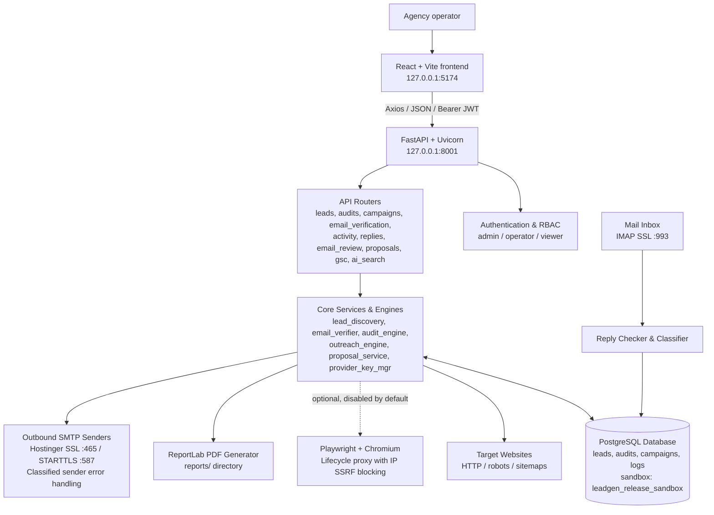
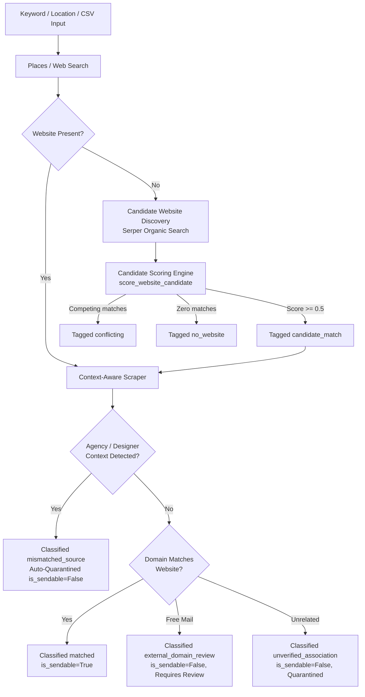
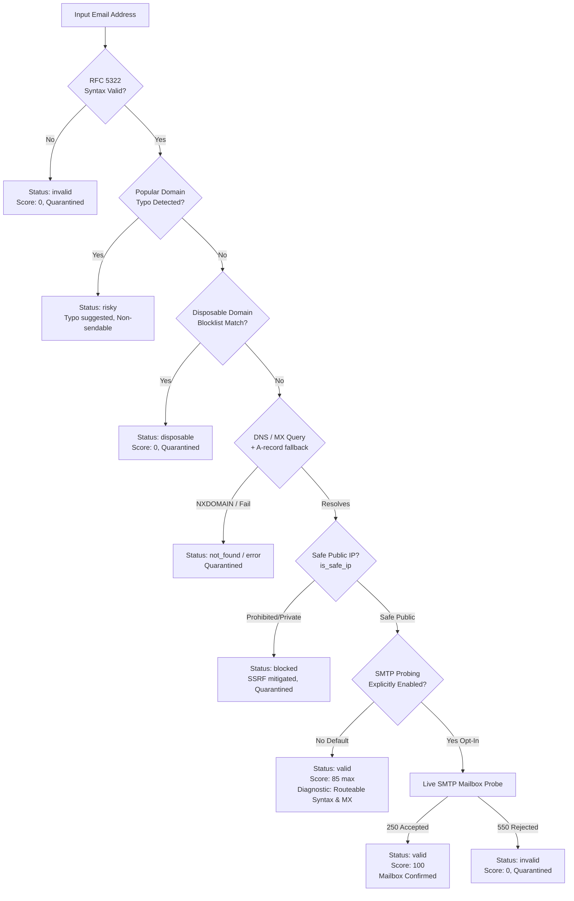
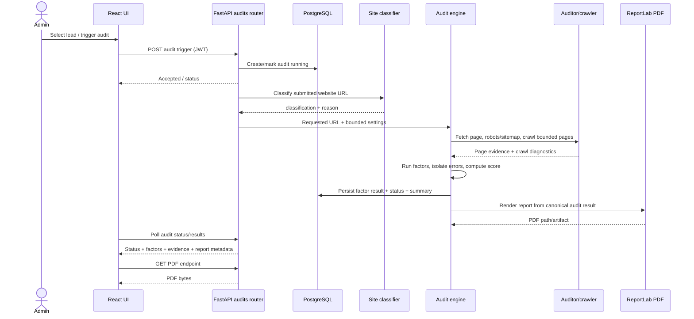
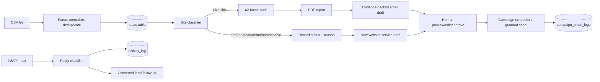
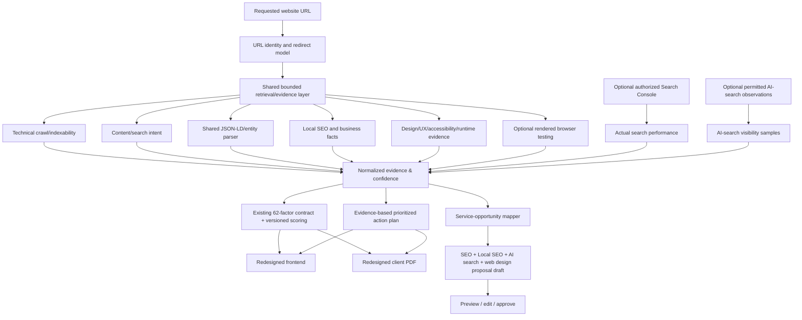
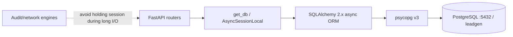
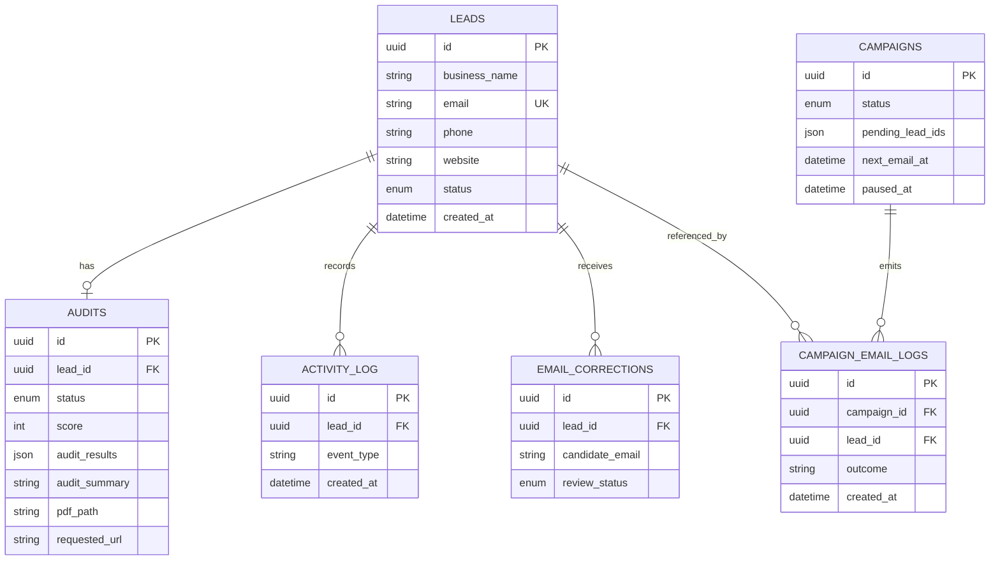

# LEADGEN — System Architecture & Product Documentation

**Product:** TEB Solutions LeadGen OS  
**Document type:** Product + technical architecture reference  
**Baseline reported:** Published `main` at `1253824` (`fix: bound synchronous audit network work`)  
**Working checkout:** `C:\Users\LENOVO\LEADGEN-RELEASE`  
**Original checkout (protected):** `C:\Users\LENOVO\LEADGEN`  
**Status:** Current-state reference reconciled with source-code evidence plus explicitly labeled target architecture  
**Prepared:** 15 October 2026  
**Reconciled & Synchronized:** 19 October 2026  

> **Read this before implementation.** This document separates documented/current capabilities from proposed future capabilities. Do not treat a planned capability as implemented. Current file structure, endpoint routes, factors, settings, schemas and scripts have been reconciled against the active checked-out source in `C:\Users\LENOVO\LEADGEN-RELEASE` as of commit `c0a5947`.
>
> **Note on Companion PDF (`LEADGEN_SYSTEM_ARCHITECTURE_PRODUCT_DOCUMENTATION.pdf`):** The pre-compiled PDF document in `docs/` reflects the earlier October 15, 2026 baseline. In the absence of an automated in-workspace PDF regeneration and visual verification pipeline for this architecture document, the PDF is preserved unchanged to prevent artifact corruption, and this Markdown document stands as the authoritative editable reference.

---

## 1. Executive summary

LEADGEN is an internal lead-generation and website-audit operations platform for TEB Solutions. It brings together business lead intake, website classification, candidate website discovery, a technical/SEO audit, score/finding persistence, PDF generation, email verification and deliverability gating, personalized email outreach, campaign management, and reply handling.

The application is a local Windows-oriented stack:

- **Frontend:** React 18 + Vite + Axios (with JWT interceptor) + Tailwind CSS on `127.0.0.1:5174`.
- **Backend:** Python 3.11+ / 3.14 compatible, FastAPI, Uvicorn, SQLAlchemy 2.x async, Pydantic v2 settings/schemas, `psycopg` v3 on `127.0.0.1:8001`.
- **Storage:** PostgreSQL; default local database name is `leadgen`; tests and migrations isolated to `leadgen_release_sandbox`.
- **Audit Engine:** an `auditor` Python package with HTTP fetching/parsing, 62 canonical factors across 11 groups verified via strict parity validator, an optional Playwright/Chromium browser-evidence path (disabled by default), bounded crawling/network work, and score-neutral lab metrics.
- **Verification & Deliverability Hub:** 6-layer asynchronous verifier (RFC 5322 syntax, popular domain typo suggestions, disposable domain frozenset, async DNS/MX with A-record fallback, SSRF IP filtering, and permanent disabled-by-default SMTP/catch-all probing).
- **Outreach & Gatekeeper:** Fail-closed pre-send gatekeeper enforcing positive association allowlists (`matched`, `approved`), outbound SMTP sender classification (553 5.7.1 ownership rejection handling), campaign auto-pause, and IMAP reply triage.
- **Reports:** ReportLab PDF generation for client audit reports.
- **Local ports:** API `127.0.0.1:8001`, frontend `127.0.0.1:5174`, PostgreSQL commonly `localhost:5432`.
- **Git:** Active branch `fix/audit-url-sitemap-correctness` at `c0a5947` with working-tree verification and deliverability implementations.

### Important truth about status

The normal audit workflow and PDF were verified end-to-end against `python.org` in a disposable database, and optional browser evidence passed local fixture tests. The Car Medic Motors report correctness defects (URL identity separation, origin-root sitemap discovery, shared JSON-LD extraction, and impact-based priority classification) were addressed and verified in regression tests (`tests/test_audit_correctness_url_sitemap_schema.py`). The Email Deliverability & Verification Hub, candidate website discovery, and fail-closed campaign gatekeeper are implemented and verified via automated test suites. Advanced multi-page browser crawling, Lighthouse integration, and cloud production deployment remain planned roadmap items.

---

## 2. Status legend: current vs target

| Label | Meaning |
|---|---|
| **Current / documented** | Described in the source project documents or directly reported as part of the published release. Verify implementation before modifying. |
| **Verified in tests** | A specific behavior was tested with named test suites/controlled run. This is not a universal runtime guarantee. |
| **Known defect / unverified** | Evidence shows incorrect behavior, or the behavior has not yet been validated. |
| **Target / planned** | Part of the desired product architecture, but not claimed as implemented. |
| **Optional integration** | Requires separate authorization, provider account, data access or configuration. |

### Current vs target capability matrix

| Area | Current documented state | Desired target state |
|---|---|---|
| Leads & Intake | CSV import/deduplication, edit/list/delete/bulk operations | Preserved; keyword/location bulk import verified |
| Provenance & Discovery | Context-aware HTML extraction, agency footer credit filter, candidate scoring (`score_website_candidate`), ccTLD alignment | Fully automated discovery and association confidence scoring |
| Site classification | 13-layer classifier, several URL variants and parking/demo checks | Preserved; separates requested URL from final redirect URL |
| SEO audit | Canonical 62 factors / 11 groups strictly validated across all 6 tiers | Same contract, better accuracy/evidence, more advanced diagnostics without factor/weight changes |
| Crawl/sitemap | Crawl limits (10 default, 25 hard cap), origin-root robots/sitemap discovery | Bounded multi-page crawl coverage (Phase 3 WS-C) |
| Browser Evidence | Optional Playwright/Chromium capture, disabled by default; lifecycle proxy with IP SSRF blocking | More complete design/JS/performance diagnostics; strictly bounded lab data |
| Email Verification | 6-layer async verification (Syntax, Typos, Disposable, DNS/MX, SSRF safety); permanent disabled-by-default SMTP/catch-all probing; score capped at 85 | Preserved; live SMTP optional opt-in only |
| Campaign Gatekeeper | Fail-closed positive allowlist (`matched`, `approved`, `valid`, not quarantined); authenticated approval endpoint; quota protection | Preserved; strict protection of outbound sending quotas |
| SMTP Error Handling | Permanent sender classification (553 5.7.1 ownership, 535 auth, 550 quota); campaign auto-pause; password redaction; preserves recipient status | Multi-sender failover pool |
| Performance | Existing response-time/page-size and score-neutral lab web-vitals work (LCP, CLS, TTFB) | Repeated lab runs; field metrics only from real authorized field data |
| Frontend | React 18 + Vite operational UI; unified Audits page with Website SEO vs Email Deliverability tabs; candidate badges; dual CSV exports | Complete interactive browser acceptance testing across all viewports |
| PDF Reports | Multi-section ReportLab client audit report with dynamic 62-factor sections | Additional bespoke proposal templates |
| Search Console | AES-GCM encrypted credential persistence, OAuth flow implemented | Verified with live production client credentials |
| AI search visibility | Heuristics implemented; Perplexity, Gemini, OpenRouter, Groq providers integrated | Continuous scheduled visibility tracking |
| Deployment | Local Windows workflow; remote Git publication; safe port-specific `STOP.bat` | Authorized cloud production target and automated CI/CD pipeline |

---

## 3. Product purpose and user journeys

### Primary users

- **Agency operator/admin:** imports prospects, reviews leads/audits, manages outreach, handles replies.
- **SEO/web consultant:** interprets evidence, prioritizes fixes, prepares service proposals and client deliverables.
- **Client/prospect (indirect recipient):** receives an understandable and accurate audit report or service proposal.

### Main workflows

1. **Lead intake:** CSV upload → normalization/deduplication → database lead record.
2. **Website classification:** try safe URL variants → classify as real, parked, demo, not found or unreachable → preserve the original user-submitted website identity.
3. **Audit:** fetch page → identify requested/final/canonical URL separately → robots/sitemap → bounded crawl → execute factors → optional browser capture → aggregate results and score.
4. **Persistence:** store audit status, result fields/JSON, summary and report path using current model/schema patterns. Do not assume undocumented extra tables.
5. **Report:** build PDF from the persisted/structured audit result, not from duplicated or independently recomputed facts.
6. **Outreach draft:** map a small number of high-confidence findings to a relevant service offer; allow human review.
7. **Campaign:** validate that selected leads are audit-ready, send under rate/opt-out controls, log each send/skip/failure, allow pause/resume.
8. **Replies:** IMAP sync → classify positive/STOP/bounce/OOO/other → update/review leads and show converted lead follow-up workflow.
9. **Ongoing improvement:** known-site fixture regression corpus → tests → visual QA → controlled live validation → release decision.

---

## 4. High-level system architecture



### Architectural boundaries

- **Frontend Client Boundary:** React/Vite runs client-side; business rules, fail-closed gates, secret keys, and database connections remain strictly backend-side.
- **Authentication & RBAC Boundary:** All lead modification, export, audit triggering, and campaign dispatch endpoints require JWT authentication. State mutations require `admin` or `operator` roles; `viewer` is restricted to read-only views.
- **Fail-Closed Association & Gatekeeper Boundary:** Outbound email dispatch is restricted by a strict positive allowlist (`matched` or `approved` association, non-quarantined, valid verification). Unverified or legacy records fail closed.
- **Deliverability & Verification Boundary:** Email verification operates without invasive mailbox probing by default (`smtp_probe_enabled=False`). Verification scores are capped at 85 without a live SMTP probe, reporting `Routeable (Syntax & MX)` rather than guaranteeing delivery.
- **Audit Engine Baseline Boundary:** Canonical 62 audit factors across 11 groups are preserved invariantly. Browser evidence capture is strictly optional, decoupled, and cannot alter factor scoring.
- **Database Isolation Boundary:** Live operations default to `leadgen`; testing and migrations are restricted to `leadgen_release_sandbox` using non-superuser credentials.

---

## 4.1 Detailed Architecture Sub-Views

### A. Lead Discovery & Provenance Flow


### B. Email Verification & Deliverability Lifecycle


### C. Campaign Pre-Send Gatekeeper & SMTP Sender Failure Handling
```mermaid
flowchart TD
    QUEUE[Campaign Recipient Queue] --> GATE{Pre-Send Gatekeeper\nCheck All 3 Conditions}
    GATE -->|1. assoc in ('matched', 'approved')\n2. not is_quarantined\n3. email_verification == 'valid'| SEND_PREP[Prepare Email Payload]
    GATE -->|Any condition fails| ABORT_SEND[Skip Recipient\nLog CampaignEmailLog: skipped\nQuota untouched, sent_count unaffected]
    SEND_PREP --> SMTP_DISPATCH[Outbound SMTP Dispatch via Provider]
    SMTP_DISPATCH -- Success --> LOG_OK[Log CampaignEmailLog: sent\nIncrement sent_count]
    SMTP_DISPATCH -- Failure --> CLASSIFY[classify_smtp_error]
    CLASSIFY --> PERM_CHECK{Permanent Sender Failure?\n553 ownership, 535 auth, 550 quota}
    PERM_CHECK -- Yes --> PAUSE_CAMP[Pause Campaign Immediately\ncampaign.status = paused\nPreserve recipient verification status\nPrevent repetitive failures]
    PERM_CHECK -- No Recipient Rejection --> LOG_FAIL[Log failure\nReset lead status to fresh]
```

---

## 5. Runtime sequence diagrams

### A. Audit sequence



### B. CSV → audit-ready lead → proposal workflow



### C. Target-state advanced audit data flow (planned)



**Target-state diagram is proposed architecture.** Search Console, live AI-search observation, new design audits and the redesigned frontend/PDF should not be reported as implemented until code and tests prove that status.

---

## 6. Technology stack and platform connections

| Layer | Technology / tool | Purpose / state |
|---|---|---|
| Operating environment | Windows 11 (reported) | Local agency workstation |
| Python runtime | Python 3.14 (reported) | Backend and auditor runtime |
| API framework | FastAPI | REST endpoints, schema validation, auth dependency wiring |
| ASGI server | Uvicorn | Serves API on port 8001 |
| Python async DB access | SQLAlchemy 2.x async + psycopg v3 | ORM/session and PostgreSQL driver; selector-loop fix committed for Windows |
| Database | PostgreSQL | Leads, audits, campaigns, activity/reply/quality-operation records |
| Frontend | React 18 + Vite | UI dev/build/preview, default local port 5174 |
| HTTP from UI | Axios | Calls backend APIs; JWT interceptor documented |
| UI styling | Plain CSS/design tokens | Existing CSS approach; project docs warn against unsupported Tailwind `@apply` usage |
| HTTP/site inspection | `requests`, `aiohttp` (documented) | Fetch pages and resources, redirects and headers |
| HTML/XML parsing | BeautifulSoup4, `lxml` | Extract HTML, links, headings, metadata, sitemap XML |
| Browser evidence | Playwright + Chromium | Optional rendered page capture, JavaScript differences, errors and failed requests |
| Browser security | Policy-aware proxy and URL/IP validation (documented) | SSRF/private IP/redirect/subresource protections |
| PDF generation | ReportLab | Multi-section PDF report and attachment |
| Auth | JWT (`python-jose`) + bcrypt (documented) | Admin auth and endpoint protection |
| SMTP | `smtplib`; Hostinger/Gmail settings documented | First-touch and follow-up outreach; 465 SSL or 587 STARTTLS |
| IMAP | `imaplib` with SSL (documented) | Inbox synchronization and reply classification |
| Tests | pytest; Python `unittest` in some reported tasks; Node verifier | Offline unit/contract/security/browser/PDF checks |
| Frontend build | npm scripts + Vite | Production assets and local preview |
| Git hosting | GitHub remote `epromotors/LEADGEN` | Source publication; release report said no configured cloud deployment pipeline |

### Ports and protocols

| Port | Service | Notes |
|---:|---|---|
| 8001 | FastAPI/Uvicorn | Bind to loopback for local use unless a deliberate deployment design changes it |
| 5174 | Vite frontend | Dev or preview depending on command; local UI |
| 5432 | PostgreSQL | Local DB in documented environment |
| 465 | SMTP SSL | Outbound mail |
| 587 | SMTP STARTTLS | Alternative outbound mail |
| 993 | IMAP SSL | Inbox sync |

### Important configuration variables (names only; never document their values)

- `DATABASE_URL`
- `JWT_SECRET`, `JWT_ALGORITHM`, `JWT_EXPIRE_MINUTES`
- `ADMIN_USERNAME`, `ADMIN_PASSWORD`
- `INIT_SCHEMA` (false by default after schema safeguard commit)
- `BROWSER_ENABLED` (false by default)
- `CRAWL_MAX_PAGES` (default 10, allowed 1–25, hard max 25 per committed limit policy)
- `FRONTEND_URL`
- `REPORTS_DIR`
- `SMTP_SENDERS`

Do not place secrets, connection strings or real credentials in documentation, logs, source, test fixtures or commits.

---

## 7. Project structure: important source paths

The following reflects the documented layout; verify exact paths against the release checkout.

```text
LEADGEN-RELEASE/
├── README.md / SYSTEM.md / ARCHITECTURE.md / CHANGELOG.md
├── LEADGEN_MASTER_PRODUCT_PLAN.md (agent scope plan, intended docs destination: docs/)
├── backend/
│   ├── run.py                         # Windows-compatible Uvicorn entry point
│   ├── requirements.txt               # Python dependencies
│   ├── reset_leads_to_fresh.py        # State-maintenance utility; destructive, review before use
│   ├── gen_preview.py                 # Offline outreach email preview
│   ├── reports/                       # Generated report output (normally gitignored)
│   └── app/
│       ├── main.py                    # FastAPI app, middleware/CORS/router mount
│       ├── config.py                  # Pydantic settings / environment
│       ├── database.py                # Async engine and session dependency
│       ├── models.py                  # SQLAlchemy ORM models
│       ├── schemas.py                 # Pydantic API input/output contracts
│       ├── routers/
│       │   ├── auth.py                # Login/JWT
│       │   ├── leads.py                # CSV, read/edit/delete/bulk operations
│       │   ├── audits.py               # Trigger, status, result, PDF, batch stats
│       │   ├── campaigns.py            # Campaign CRUD/send/pause/resume/reset/test
│       │   ├── activity.py              # Activity log and metrics
│       │   ├── replies.py               # Inbox/replies/follow-up preview and send
│       │   └── email_review.py          # Email mismatch scan/accept/dismiss
│       ├── engines/
│       │   ├── audit_engine.py          # Bridge between API/DB and auditor package
│       │   ├── pdf_engine.py            # ReportLab integration at backend level
│       │   ├── outreach_engine.py      # Personalized first-touch and proposal emails
│       │   └── reply_engine.py          # IMAP and reply classification
│       └── utils/
│           ├── csv_parser.py            # CSV normalization/deduplication
│           ├── site_checker.py          # Website classification
│           └── spintax.py               # Email subject/body variation helpers
├── auditor/auditor/auditor/
│   ├── core.py                          # Session/fetch/result helpers
│   ├── technical.py                     # SSL, robots, sitemap, canonical, favicon, mobile
│   ├── onpage.py                         # Title/meta/headings/internal links/anchors
│   ├── images.py                         # Alt/WebP/lazy-load checks
│   ├── links.py                          # Link status/broken links
│   ├── social.py                         # Social, contact and WhatsApp links
│   ├── trust.py                          # Trust/legal page checks
│   ├── ux.py                             # CTA/hero/font/contrast/navigation/etc.
│   ├── indexability.py                   # Robots/noindex/URL/soft-404 checks
│   ├── content.py                        # Content and metadata checks
│   ├── local_seo.py                      # Local business/NAP/maps/location/hours
│   ├── performance.py                    # Page weight/TTFB/resources/compression
│   ├── schema.py / schema_advanced.py    # JSON-LD/Open Graph/advanced schema
│   ├── crawler.py                        # Bounded multi-page crawling
│   ├── runner.py                         # Auditor orchestration
│   └── pdf_builder.py                    # ReportLab auditor-package PDF builder
├── auditor/auditor/browser/
│   ├── provider.py                       # BrowserProvider and structured evidence
│   ├── security.py                       # URL/IP checks
│   ├── proxy.py                          # Browser policy-aware outbound proxy
│   └── comparisons.py                    # Raw vs rendered evidence annotation
├── frontend/
│   ├── package.json                      # Dev/build/preview scripts
│   ├── vite.config.js                   # Vite port/proxy
│   └── src/
│       ├── App.jsx / main.jsx / index.css
│       ├── api/client.js                 # Axios API client/auth handling
│       ├── components/Layout.jsx
│       ├── components/BrowserEvidence.jsx (documented)
│       └── pages/                        # Dashboard, Leads, Audits, Campaigns, Inbox, etc.
└── tests/
    ├── test_audit_observability.py
    ├── test_factor_registry.py / test_factor_parity.py / test_factor_execution.py
    ├── test_scoring.py / test_structured_values.py / test_lifecycle.py
    ├── test_crawl_failure.py / test_classifier_failure.py
    ├── test_pdf_contract.py / test_api_contract.py
    ├── test_phase2_browser_provider.py / test_phase2_verification.py
    ├── test_phase2_security_review.py / test_phase2_security_followup.py
    ├── test_phase3_workstream_b.py / test_phase3_workstream_c.py
    └── test_startup_schema_safeguard.py / test_dns_rebinding_proxy.py
```

### Scripts and commands catalog

| Script/command | Purpose | Risk note |
|---|---|---|
| `backend/run.py` | Backend entry point with Windows selector-loop behavior | Normal service startup; check config/ports first |
| `npm run dev` | Vite development server | Uses live backend API if configured |
| `npm run build` | Build frontend production bundle | Safe local build; may create ignored `dist/` files |
| `npm run preview` or Vite preview command | Serve compiled frontend locally | Bind to loopback for smoke tests |
| `python -m pytest ...` | Unit, integration, security, contract tests | Inspect tests for external network/DB side effects first |
| `frontend/scripts/verify-browser-evidence.mjs` | Frontend browser-evidence rendering contract verifier (documented) | Use local fixtures/mocks |
| `scripts/validate_agent_brain.py --strict --report` | Validate canonical factor/agent brain contract | Safe local validation if configured read-only |
| `backend/gen_preview.py` | Build outreach email preview | Avoid sending messages |
| `send_test_email.py` / backend counterpart | Send a real test email | **Side-effecting**; never run without explicit recipient/test authorization |
| `backend/reset_leads_to_fresh.py` | Clear tracking/reset campaign/repair stale states | **Destructive DB operations**; never run casually |
| `START.bat` / `STOP.bat` | Legacy launcher/stopper | STOP is broad process termination; avoid under current safety rules |
| `git fetch origin` | Refresh remote metadata | Network operation; no source publish |
| `git push` | Publish Git commits | Requires explicit release authorization |

---

## 8. Database architecture

### Connection model



Documented code uses SQLAlchemy async sessions and `psycopg` v3. The release includes a Windows selector event-loop fix and a safeguard that skips automatic schema initialization unless `INIT_SCHEMA=true` is explicitly set. These rules protect the existing DB from startup-time DDL; they do not make application-level API writes read-only.

### Logical entity relationship model



**ERD caution:** fields in the diagram are conceptual/logical. Actual ORM/table/column names and types must be rechecked in `backend/app/models.py`; do not apply this diagram as DDL. In particular `audit_results`, `score`, UUID ID shapes and log FK relations must be verified from the checked-out source before implementation/migration.

### Documented logical tables

| Table | Purpose | Representative data |
|---|---|---|
| `leads` | Source business/contact records | Business name, email, phone, website, current workflow status, timestamps |
| `audits` | Current/latest SEO audit per lead (documented relationship) | Audit lifecycle, factor fields/results, site status/error reason, summary, PDF path |
| `campaigns` | Outreach campaign state | Status, selected/pending lead IDs, next send, paused time, counters |
| `campaign_email_logs` | Per-recipient send history | Sent/failed/skipped state and timestamps |
| `activity_log` | Operational event history | Activity type, references, timestamp/context |
| `email_corrections` | Email mismatch review queue | Candidate correction, pending/accepted/dismissed status |

### Data integrity policies

- An audit must be in the successful terminal state before a lead is campaign-ready; lead status alone is insufficient.
- Keep existing FK/cascade semantics and delete behavior; do not run broad cleanup queries.
- Use DB sessions for short database operations; do not hold a session open while making long website/network calls.
- Add indexes/migrations only after schema review and explicit approval for any protected/existing database.
- Keep report path/artifact ownership explicit and clean up only artifacts created by a test.
- Store audit evidence with clear status/error semantics. Do not continue using an ambiguous error string as both a state and an error without a compatible normalization plan.

---

## 9. API architecture and documented surface

Authentication is documented as JWT bearer token. `/api/auth/login` is exempt; the other endpoints below are documented as protected. Exact prefixes/mounts can drift between documentation and the actual router definitions; `http://127.0.0.1:8001/docs` (OpenAPI) and `backend/app/main.py` are the runtime truth and must be checked before client integration.

### Authentication / leads

| Method | Documented path | Purpose |
|---|---|---|
| POST | `/api/auth/login` | Authenticate admin; returns access token |
| POST | `/api/leads/upload` | Upload/import a lead CSV |
| GET | `/api/leads/` | List leads with pagination/status filters; includes audit readiness data |
| DELETE | `/api/leads/{id}` | Delete lead under established cascade rules |
| POST | `/api/leads/bulk-delete` | Bulk delete selected leads |
| POST | `/api/leads/clean-urls` | Normalize stored website URLs (potentially changes data; explicit use only) |
| POST | `/api/leads/clean-names` | Clean lead names (potentially changes data; explicit use only) |

### Audits / PDF

| Method | Documented path | Purpose |
|---|---|---|
| POST | `/api/audits/trigger/{id}` | Trigger audit in background; returns accepted status |
| POST | `/api/audits/trigger-all` | Bounded batch audit; conflict guard prevents duplicate batch |
| GET | `/api/audits/stats` | Batch and audit status counts |
| GET | `/api/audits/{lead_id}` | Fetch audit record/factor results |
| GET | `/api/audits/pdf/{lead_id}` | Stream generated PDF |

### Campaigns / activity / replies / email review

| Method | Documented path | Purpose |
|---|---|---|
| GET/POST | `/api/campaigns/` | List/create campaigns; creation checks audit readiness |
| POST | `/api/campaigns/{id}/send` | Start campaign send workflow |
| POST | `/api/campaigns/{id}/reset` | Reset stuck campaign (state-changing) |
| POST | `/api/campaigns/send-test` | Sends actual test email; side-effecting |
| GET | `/api/activity/` | List activity events |
| GET | `/api/activity/metrics` | Dashboard KPI metrics |
| POST | `/api/replies/check-now` | Sync IMAP inbox (external side effect/read) |
| GET | `/api/replies/converted` | List converted leads and context |
| GET | `/api/replies/stats` | Reply/categorization counters |
| GET | `/api/replies/preview-email2/{id}` | Generate preview of follow-up proposal |
| POST | `/api/replies/send-email2/{id}` | Sends follow-up email and may attach PDF; side-effecting |
| PATCH | `/api/replies/reclassify/{id}` | Change reply category/lead state |
| POST | `/api/email-review/scan` | Scans lead emails for possible mismatches; assess DB writes in implementation |
| GET | `/api/email-review/` | List pending/accepted/dismissed corrections |
| GET | `/api/email-review/stats` | Correction review counts |
| POST | `/api/email-review/{id}/accept` | Applies candidate email to lead; mutating |
| POST | `/api/email-review/{id}/dismiss` | Dismiss candidate correction |

### API design target

- Version API request/response shapes where major semantics change.
- Keep JWT and secret handling server-side.
- Provide consistent error envelopes and request correlation IDs.
- Expose audit lifecycle, requested/final/canonical URLs, crawl coverage, and retrieval limitations distinctly.
- Return factor-level evidence and priorities in one canonical result contract consumed by UI and PDF.
- Use idempotency/duplicate-trigger guards for expensive audit operations.
- Keep send/reply operations explicitly side-effecting and out of automatic audit tests.

---

## 10. Audit engine: current contract and target improvements

### Current documented factor groups

The most recent strict validator/release evidence reports **62 canonical factors across 11 groups**. Older `README.md`/`SYSTEM.md` entries still describe a 55-factor version. This is documentation drift: use the current checked-out `factor_contract`, registry, validator and tests as runtime authority, and update docs only after verifying the exact canonical factor list.

| Group | Primary focus (current/documented) |
|---|---|
| Technical | TLS/SSL, robots, sitemap, canonical, redirects, viewport/technical setup |
| On-page | Title, meta description, headings, internal links, anchor text |
| Images | Alt attributes, formats, lazy loading |
| Links | Internal/outbound link status and broken links |
| Conversion | Social/contact/WhatsApp presence and contact path |
| UX | CTA, hero message, font sizing, contrast, navigation, trust notices, address/phone |
| Indexability | `noindex`, URL structure, host variants, soft 404 |
| Content | Word count/content extraction, duplicate metadata, title keyword, reading-level heuristic |
| Local SEO | Name/address/phone, local schema, map, city and hours signals |
| Performance | Response timing, page bytes, render blocking, compression, image/resource checks |
| Advanced schema | FAQ/Product/Breadcrumb/Review/JSON-LD graph checks |

### Canonical result lifecycle

1. Validate requested URL.
2. Preserve requested URL.
3. Fetch and record final response URL/redirect chain.
4. Parse canonical URL as metadata only.
5. Share one bounded HTML response and parsed evidence where possible.
6. Fetch site-wide robots.txt from the origin root.
7. Discover and validate sitemap(s), obey caps and security filters.
8. Crawl internal pages with depth/page/time/size limits.
9. Run factor checks with isolated exception handling and per-factor diagnostics.
10. Normalize status/evidence/priority and calculate score with the existing canonical scoring contract.
11. Persist result and report artifact through the existing path.
12. Present identical result semantics in frontend and PDF.

### Required data separation

`requested_url` ≠ `final_url` ≠ `canonical_url`.

Also distinguish:

- Confirmed defect vs retrieval failure vs incomplete evidence vs not-applicable.
- Raw HTML vs rendered DOM evidence.
- Lab/synthetic performance vs field data.
- Heuristic AI-search readiness vs measured AI search citations.
- Visible page data vs JSON-LD-only claims.
- Status (`PASS/WARN/FAIL/ERROR/N/A`) vs action priority (`Critical/High/Medium/Low/Info`).

---

## 11. Target architecture: eight advanced domains plus web-design/code-health

All items below are **target capabilities**, unless confirmed by implementation during the master plan execution.

### A. AI-search readiness and visibility

- Readiness: crawlability, entity consistency, clear text, structured data matching visible content, useful question-answer content, attribution/author/date where relevant.
- Visibility: a repeatable query set across brand/services/locations/questions and dated answer/citation capture from permitted and reproducible sources.
- Record engine/source, query, time, locale, response excerpt, citations, method, coverage and uncertainty.
- Never guarantee AI visibility or fabricate answer appearances. `llms.txt` is informational only; do not treat it as a ranking guarantee.

### B. Deep technical SEO/crawlability

- Redirect loops/chains, status codes, URL variants, canonical and noindex contradictions, robots and sitemap health, sitemap-vs-crawl coverage, orphan/crawl-depth/internal-link graph, resource failures, query/trailing slash variants, raw-vs-rendered content differences.

### C. Real search performance / Google Search Console

- Optional user-authorized Google OAuth connection; read-only scope where sufficient; clicks/impressions/CTR/position by query/page/country/device/date; supported URL inspection coverage; high-impression/low-CTR candidates and trend/overlap insights only where data supports them.
- Show disconnected/unauthorized/empty-data states honestly; never store or request a user's Google password.

### D. Advanced performance/browser

- Keep LCP/CLS/TTFB lab work distinct from field metrics. Add repeat-run diagnostics, resource timing, JS errors, failed requests, asset weights, mobile viewport behavior, render blockers, and measured uncertainty.
- Core Web Vitals use LCP, INP and CLS. Lab runs alone do not establish actual field INP or 75th-percentile results.

### E. Content/search intent

- Better main-content extraction, near-duplicate/cannibalization candidates, content freshness, heading/metadata coverage, topic/question gaps from actual query data when available, internal contextual links and intent match. Avoid generic word-count thresholds as universal truth.

### F. Local SEO/entity consistency

- Separate visible NAP, JSON-LD NAP and authorized third-party listing data. Compare business entities, service/location pages, opening hours, maps/contact, appropriate schema and consistency across site locations.

### G. Accessibility/trust/usability/conversion

- Keyboard/focus/name/label checks, contrast when measurable, viewport overflow, tap targets, form usability, contact conversion paths, trust page presence. Legal/cookie observations must be cautious and jurisdiction-aware, not legal advice.

### H. Web design, UI/UX and observable code health

- Layout/visual hierarchy, responsive breakpoints, overflow/clipping/overlap, typography, spacing, contrast, CTA and form flow, navigation, links/assets, console/runtime errors, failed CSS/JS, resource weight, semantic HTML/headings/accessible controls, cross-page design consistency and page-template weaknesses.
- Provide screenshot/viewport/URL/request evidence for observable browser findings. Do not claim source-code defects when only live HTML/runtime evidence is available; source-code review requires authorized source access.

### Cross-domain outputs

These domains feed a shared evidence layer, then the unchanged baseline 62-factor scoring (unless a later versioned scoring change is explicitly approved), evidence-based priority policy, frontend, PDF and service-opportunity workflow.

---

## 12. Frontend product target

### Current documented pages

- Login
- Dashboard/KPIs/activity
- Leads table/import/edit/bulk actions/audit polling
- Audits with score/factor details and PDF access; browser evidence component documented
- Campaigns with controls/progress/logs/test-send
- Email mismatch review
- Activity log
- Inbox/converted leads/follow-up preview/edit/send

### Target design outcomes

- Clear site/audit overview, date/status and requested/final/canonical URL identities.
- Score and Pass/Warn/Fail/Error distribution with category breakdown.
- Prioritized finding cards with evidence, target URL, confidence and action.
- Crawl/sitemap status and page coverage.
- Browser/rendered-vs-raw evidence when available.
- Lab/field performance distinction.
- AI/search-source panel only when real source data exists.
- Website-design/UX screenshots and reproduction notes where available.
- Better loading, incomplete/error, empty, stale-audit and permission states.
- Responsive layout, keyboard operation, accessible contrast and reusable design tokens.

### Frontend acceptance proof

A successful Vite build is necessary but insufficient. Provide before/after screenshots from the actual page. Verify the dashboard uses real API data and does not invent capabilities for unconnected integrations.

---

## 13. PDF/report target

### Current

ReportLab creates a multi-page branded report with score, category tables, factor status/findings, priority action plan and site-wide crawl summary. The supplied PDF confirms the current appearance is not the intended redesign and its findings were contradictory.

### Desired client report sections

1. Premium TEB Solutions cover and correctly identified site.
2. Executive summary and honest score/context.
3. Audit scope and requested/final/canonical URL provenance.
4. Score/category distribution matching API results.
5. Evidence-based prioritized action plan.
6. Detailed findings: status, priority, inspected URL, evidence, why it matters, exact corrective action.
7. Technical diagnostics: redirects, robots, sitemap source/status/XML validation, crawl coverage.
8. Content, Local SEO, schema and accessibility findings.
9. Performance/browser results with lab/field labels and test conditions.
10. AI-search readiness or visibility only when the relevant evidence/source was actually collected.
11. Design/UX/runtime observations and a realistic repair/redesign scope.
12. Service opportunity summary mapped to verified findings.
13. Methodology, limitations, date, page numbering and professional footer.

### PDF acceptance proof

Generate fixture reports; render pages to images; visually inspect cover, score/category pages, detailed findings, sitemap diagnostics, crawl summary, page breaks and footer. Check PDF parses; compare displayed results against API/factor results. No claim of PDF redesign without rendered before/after evidence.

---

## 14. Web-design service opportunity and email integration

The desired system connects SEO diagnostics to a credible client proposal only after the audit is correct.

### Service categories

- Technical SEO and crawlability repairs.
- On-page/content improvements.
- Local SEO/entity consistency.
- AI-search readiness and monitoring (without guarantees).
- Performance improvements.
- Web design/redesign, responsive UX, accessibility, conversion path fixes.
- Support/monitoring and implementation packages where appropriate.

### Opportunity record (target data model)

Each service opportunity should carry:

- Related factor/finding IDs.
- Exact affected URLs and collected evidence references.
- Service category and scope type (`repair`, `optimization`, `redesign`, `monitoring`).
- Confidence and prerequisites.
- Rationale and proposed next step.
- Claim provenance for any email/report text that uses it.

### Email draft policy

- Select at most 2–3 high-confidence observations.
- Map each to a relevant service: SEO, Local SEO, AI-search readiness or web design/redesign.
- Do not label an unreachable sitemap as a confirmed missing sitemap.
- Do not claim traffic/revenue loss, rankings, AI citations, or conversion lifts without verified data.
- Preview/edit/approve before sending. Do not auto-send as part of audit execution or test flow.
- Preserve unsubscribe/suppression policies, audit-readiness guards, rate limits and per-email logs.
- Automated tests use fake senders and never send real mail.

---

## 15. Existing scripts and platform operational guide

### Local startup options

Current release smoke test verified the production frontend build and local routes with database writes blocked. Normal day-to-day operation is different: normal lead/campaign operations need a writable database. Keep schema DDL disabled unless explicitly running a reviewed migration on a disposable database.

**Backend:** from `backend/`, use `python run.py`; it binds to loopback port 8001 in the verified release path.  
**Frontend development:** from `frontend/`, `npm run dev` according to package scripts.  
**Frontend production preview:** run the documented Vite preview command bound to `127.0.0.1:5174`.  
**Health/API docs:** `/health` and `/docs` on the local backend where mounted.

Do not blindly set `PGOPTIONS=default_transaction_read_only=on` for normal work: it is a smoke-test guard that deliberately blocks application writes. Conversely, do not run normal mode against production/business data merely to test startup. Confirm the effective DB name and intent.

### Typical developer commands

```powershell
# From release checkout; inspect package.json and requirements before installing/updating.
Set-Location C:\Users\LENOVO\LEADGEN-RELEASE\backend
python run.py

# Separate terminal
Set-Location C:\Users\LENOVO\LEADGEN-RELEASE\frontend
npm run dev

# Build check (safe local build, creates dist assets)
npm run build

# Safe test patterns only after inspecting side effects
python -m pytest tests/test_audit_observability.py -v
python -m pytest tests/test_factor_registry.py tests/test_factor_parity.py tests/test_factor_execution.py tests/test_scoring.py -v
python -m pytest tests/test_pdf_contract.py tests/test_api_contract.py tests/test_lifecycle.py -v
python scripts/validate_agent_brain.py --strict --report
```

Test names and commands may drift; verify paths and test side effects. Do not execute reset scripts, send-test-email scripts, or live network audit tests without explicit scoped authorization.

---

## 16. Security, reliability, privacy and safety boundaries

- JWT protects authenticated API endpoints; credential hashes/password handling and token secrets remain server-side.
- Bind local services to loopback for local use; do not expose dev server ports to LAN/internet without a deployment design.
- Keep database credentials and SMTP/IMAP secrets in an untracked local environment store.
- `INIT_SCHEMA=false` is the normal safeguard: do not use app startup to apply implicit DDL.
- Browser provider is disabled by default. Browser runs require Playwright/Chromium availability and preserve proxy-based SSRF controls.
- Keep private/loopback/link-local/metadata IP and redirect checks at request/connect boundaries.
- Apply hard page limits, sitemap limits, byte caps and finite HTTP inactivity/connect timeouts. Note that synchronous DNS and blocked system calls may not be absolutely wall-clock bounded.
- Do not treat a timeout as a confirmed SEO failure; record retrieval error/incomplete evidence.
- Audit retries must be bounded and should not create duplicate persisted records/PDFs.
- Outbound emails require explicit campaign/user action; tests never send actual emails.
- Preserve suppression/unsubscribe semantics and daily sender caps.
- Log enough correlation/stage timing to diagnose stalls, but never log secrets, full auth tokens, or full DB URLs.
- Dispose only task-owned test leads, test reports, child processes and disposable databases.

---

## 17. Implementation roadmap and gates

### Phase 0 — Source and state baseline

**Deliver:** verified branch/HEAD/status, actual code map, exact factor contract, API route inventory, model/DB inventory, current screenshots and sample PDF.  
**Gate:** no assumptions from old README silently accepted when code differs; no edits before status baseline.

### Phase 1 — Audit truth

**Deliver:** requested/final/canonical URL separation; root robots/sitemap discovery; shared JSON-LD extraction; consistent status/error semantics.  
**Gate:** deterministic regressions reproduce each known defect before fix and pass after fix.

### Phase 2 — Evidence and priority

**Deliver:** normalized evidence/provenance, priority policy, false-positive safeguards, service-opportunity traceability.  
**Gate:** no retrieval error marked as confirmed failure; no contradictory findings from identical evidence.

### Phase 3 — Advanced auditing

**Deliver:** scoped modules across seven advanced domains plus web-design/code-health; optional Search Console and AI visibility only when data source/authorization exists.  
**Gate:** each measured value has a source/method; unimplemented/unsupported sources show honest states.

### Phase 4 — Frontend redesign

**Deliver:** visible redesign, responsive layouts, accurate evidence and progress states.  
**Gate:** before/after screenshots and frontend regression/build evidence.

### Phase 5 — PDF redesign

**Deliver:** client-ready report from canonical results, better information design and useful recommendations.  
**Gate:** rendered pages visually inspected; API/DB/PDF findings match.

### Phase 6 — Service proposal workflow

**Deliver:** evidence-to-service mapping and human-approved draft emails covering relevant SEO/local SEO/AI readiness/web design services.  
**Gate:** each claim traces to a finding; no emails sent by tests; preview/edit/approve required.

### Phase 7 — Regression and benchmark suite

**Deliver:** known-site local fixture corpus, complete safe offline suite, exact execution counts, false positive/negative benchmark.  
**Gate:** tests exercise production code paths and side effects are identified.

### Phase 8 — One controlled end-to-end validation

**Deliver:** isolated disposable database, one root-URL audit, valid/persisted 62-factor result, correct sitemap/schema evidence, redesigned UI/PDF consistency, cleanup evidence.  
**Gate:** no writing to `leadgen` or `leadgen_test`; all task-owned artifacts cleaned.

### Phase 9 — Release review

**Deliver:** diff review, changelog, test/build reports, screenshots/PDF render evidence and remaining limitations.  
**Gate:** report either `READY FOR RELEASE REVIEW` or `NOT READY` with named blockers. No push/deploy until separately approved.

---

## 18. Exact known failure example to keep as a regression fixture

**Expected input URL:** `https://carmedicmotors.in/`  
**Unexpected report URL:** `https://carmedicmotors.in/lucknow`  
**Wrong reported robots URL:** `https://carmedicmotors.in/lucknow/robots.txt`  
**Contradiction:** generic schema check reports `LocalBusiness` present; dedicated LocalBusiness check reports absent.

Required future output should preserve and display requested URL, any true final redirect URL, and declared canonical URL separately; fetch root `/robots.txt`; validate its declared/fallback sitemap as XML; and make schema factors use consistent shared evidence. The live site may genuinely canonicalize `/` to `/lucknow`; only actual response/HTML evidence determines that. Never hard-code this site-specific path as a fix.

---

## 19. Glossary

- **Requested URL:** the URL submitted by the user/lead.
- **Final URL:** actual response URL after HTTP redirects.
- **Canonical URL:** page-declared preferred URL; metadata, not automatic redirect/target.
- **Origin:** scheme + hostname + effective port; used to build origin-root robots/sitemap checks.
- **Evidence provenance:** source URL, retrieval time, method, status and parsing result that support a finding.
- **Lab metric:** synthetic/browser measurement captured in a controlled test; not real-user field data.
- **Field metric:** data measured from real-user visits or an authorized external field dataset.
- **Readiness heuristic:** a proxy measure of technical/content preparation; not proof of actual AI/search visibility.
- **Visibility observation:** dated query/engine/market-specific answer or citation observation.
- **False positive:** audit reports a defect that is not actually present.
- **False negative:** audit misses a real defect.
- **Score-neutral metadata:** evidence that is displayed but does not change the canonical audit score.
- **Disposable DB:** a uniquely named database created solely for one controlled test and destroyed only after identity/cleanup verification.

---

## 20. Source and confidence notes

This architecture reference synthesizes the project documentation (`README.md`, `SYSTEM.md`, `ARCHITECTURE.md`, onboarding prompt), the master product plan, the release-readiness report, and the supplied Car Medic Motors PDF evidence. Some source documentation predates the latest 62-factor validator or describes route/module names that may drift. Before coding, revalidate exact names, signatures, model columns and API mounts from the code at `main`/the active branch.

The current-state section describes the system as documented/reported. The target sections are proposed future capability. No Search Console integration, AI-search live citation-monitoring integration, full web-code source analysis, frontend redesign or PDF redesign should be considered complete until the implementation and acceptance evidence exist.
